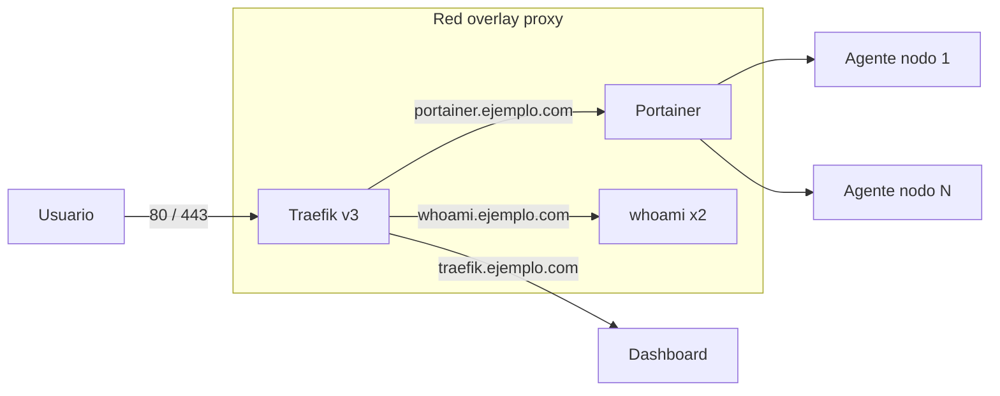

# swarm-traefik-stack

Plantilla para levantar un clúster **Docker Swarm** con **Traefik v3** como reverse proxy, **Portainer** para administrarlo y un servicio de ejemplo listo para copiar.

> *Docker Swarm template with Traefik v3 (automatic HTTPS, security middlewares, protected dashboard), Portainer and an example service.*

## Qué resuelve

- **HTTPS automático** con Let's Encrypt para cada servicio que publiques.
- **Redirección HTTP → HTTPS** en todo el clúster.
- **Middlewares reutilizables**: headers de seguridad (HSTS, nosniff, frame deny), rate limit y autenticación básica.
- **Dashboard de Traefik protegido** con usuario y contraseña.
- **Portainer** con un agente por nodo, para ver y operar todo el Swarm desde la web.
- **Actualizaciones sin corte** (`order: start-first`) en el servicio de ejemplo.
- **Métricas de Traefik** en formato Prometheus, listas para sumar a [homelab-monitoring](https://github.com/SebaAq/homelab-monitoring).

## Arquitectura



Todos los servicios que tienen que ser accesibles desde afuera se conectan a la red overlay `proxy`. Traefik lee las etiquetas (`deploy.labels`) de cada servicio y arma las rutas solo: no hay que tocar su configuración para publicar algo nuevo.

## Cómo desplegarlo

Requisitos: Docker en modo Swarm (`docker swarm init`) y un dominio cuyos subdominios apunten al nodo manager.

```bash
git clone https://github.com/SebaAq/swarm-traefik-stack.git
cd swarm-traefik-stack
cp .env.example .env      # completá DOMAIN, ACME_EMAIL y TRAEFIK_BASIC_AUTH
./deploy.sh
```

Después:

- `https://traefik.TU-DOMINIO`: dashboard de Traefik (pide usuario y contraseña).
- `https://portainer.TU-DOMINIO`: Portainer (la primera vez te pide crear el usuario admin).
- `https://whoami.TU-DOMINIO`: el servicio de ejemplo.

## Publicar tu propio servicio

Copiá el bloque `whoami` de `stack.yml` (o usalo en otro stack) y cambiá estas etiquetas:

```yaml
deploy:
  labels:
    - traefik.enable=true
    - traefik.http.routers.miapp.rule=Host(`miapp.${DOMAIN}`)
    - traefik.http.routers.miapp.entrypoints=websecure
    - traefik.http.routers.miapp.middlewares=secure-headers@swarm
    - traefik.http.services.miapp.loadbalancer.server.port=8080   # puerto interno de tu app
networks: [proxy]
```

El certificado HTTPS se pide solo la primera vez que alguien entra.

## Archivos

```
.
├── stack.yml        # Traefik, Portainer, agentes y whoami
├── deploy.sh        # lee .env, crea la red proxy y despliega
├── .env.example     # variables a completar
└── .gitignore       # .env nunca se sube
```

## Seguridad

- El socket de Docker se monta **solo lectura** en Traefik.
- `exposedbydefault=false`: ningún servicio queda publicado por accidente.
- La contraseña del dashboard se guarda hasheada (bcrypt) en `.env`, que no se sube al repo.

## Licencia

MIT
